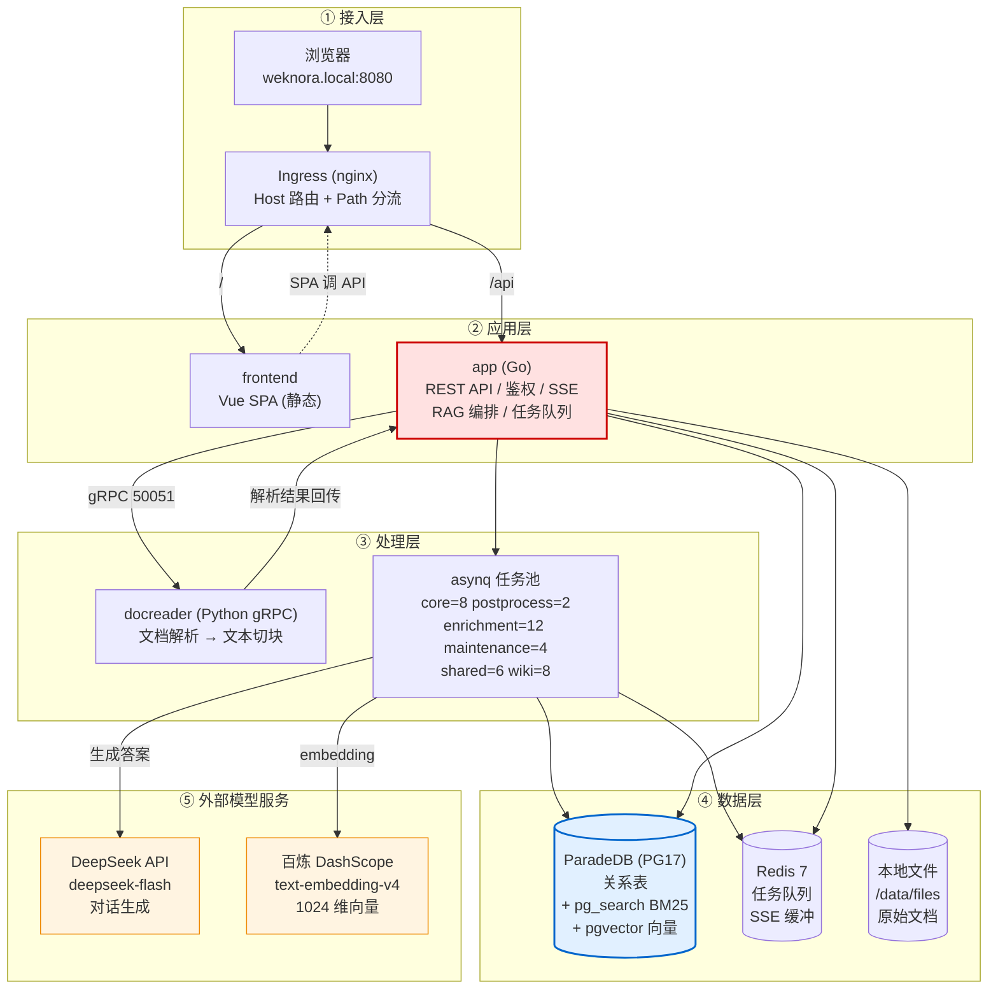
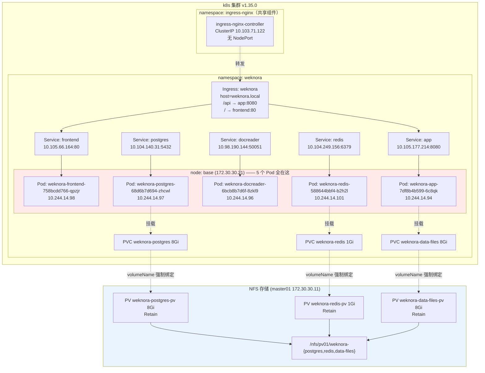
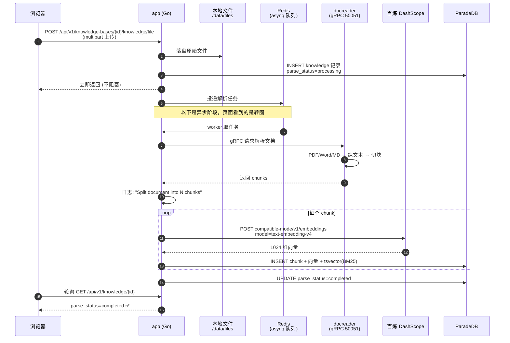
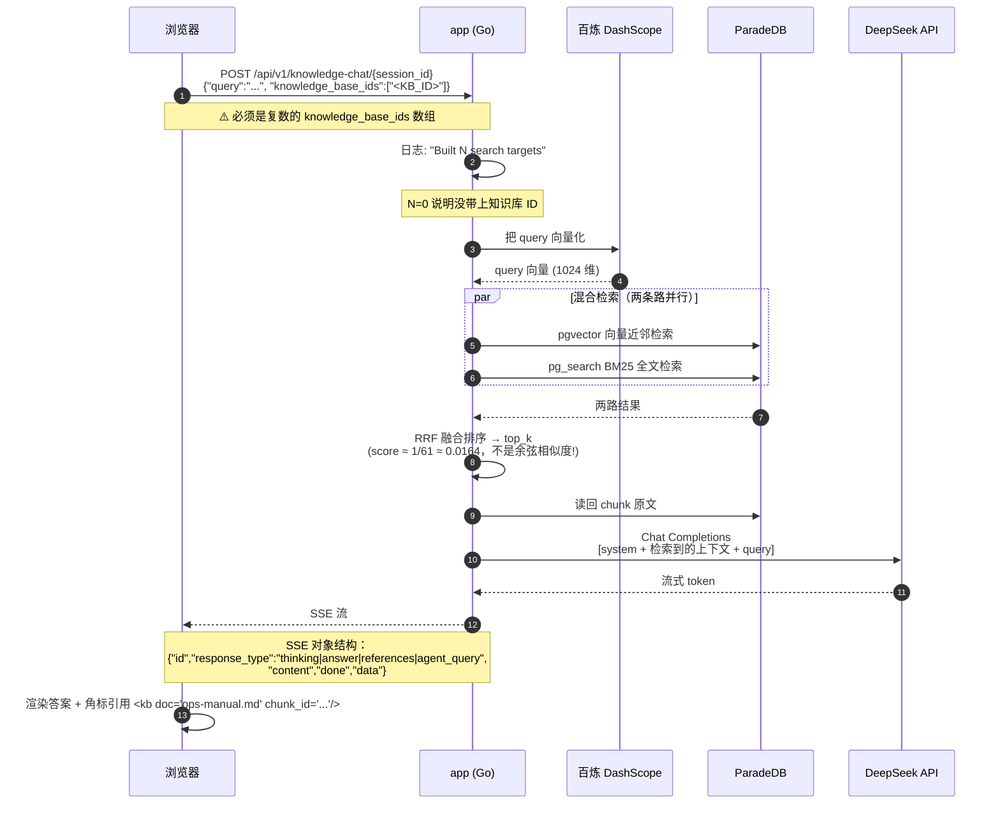
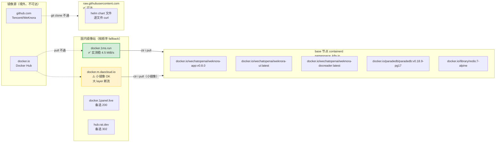
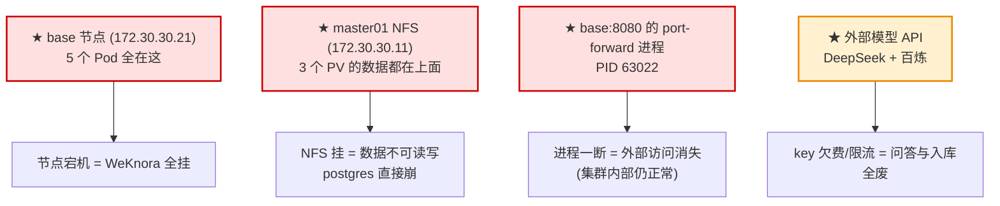

# WeKnora 架构与部署结构图（本地集群实测版）

> 整理日期：2026-09-22
> 配套文档：[`WeKnora部署完整文档.md`](./WeKnora部署完整文档.md)（部署过程 / 排障 / 从零重建）
> 本文只讲**结构**：系统长什么样、东西分别装在哪、请求怎么走、数据怎么流。
> 所有节点名、IP、Pod 名、镜像、端口、资源数字均为**本次实测值**，不是示意图。

---

## 目录

- [一、一张图看懂全貌](#一一一张图看懂全貌)
- [二、组件清单与职责](#二组件清单与职责)
- [三、逻辑分层架构图](#三逻辑分层架构图)
- [四、部署结构图（Pod / Node / 存储）](#四部署结构图pod--node--存储)
- [五、请求链路图（三条路，别混）](#五请求链路图三条路别混)
- [六、RAG 数据流图（入库 + 问答）](#六rag-数据流图入库--问答)
- [七、网络与端口矩阵](#七网络与端口矩阵)
- [八、存储结构图](#八存储结构图)
- [九、镜像来源与依赖链](#九镜像来源与依赖链)
- [十、模型服务拓扑（外部依赖）](#十模型服务拓扑外部依赖)
- [十一、命名对照表（最容易踩的地方）](#十一命名对照表最容易踩的地方)
- [十二、资源占用实测](#十二资源占用实测)
- [十三、故障域与单点分析](#十三故障域与单点分析)
- [十四、本环境相对标准架构的裁剪](#十四本环境相对标准架构的裁剪)
- [十五、关键路径速查](#十五关键路径速查)

---

## 一、一张图看懂全貌

```
┌─────────────────────────────────────────────────────────────────────────────────┐
│                          宿主机 Windows 10 (i5-7300HQ 4核4线程)                    │
│                          浏览器 http://weknora.local:8080                         │
│                          hosts: 172.30.30.21  weknora.local                       │
└───────────────────────────────────┬─────────────────────────────────────────────┘
                                    │  ① TCP 8080
                                    ▼
┌─────────────────────────────────────────────────────────────────────────────────┐
│                      目标 k8s 集群 · 3 节点 · v1.35.0                            │
│                                                                                  │
│  ┌───────────────────── master01 · 172.30.30.11 ─────────────────────┐           │
│  │ role: control-plane   内存 1218Mi/58%                              │           │
│  │ • kube-apiserver / etcd / scheduler / controller-manager          │           │
│  │ • ★ NFS 服务端：/nfs/pv01/weknora-{postgres,redis,data-files}      │           │
│  └───────────────────────────────────────────────────────────────────┘           │
│                                                                                  │
│  ┌───────────────────── node02 · 172.30.30.22 ──────────────────────┐            │
│  │ role: worker   内存 1520Mi/73%   ← 本次 WeKnora 未使用此节点       │            │
│  └──────────────────────────────────────────────────────────────────┘            │
│                                                                                  │
│  ┌═════════════★ base · 172.30.30.21 · 全部 5 个 Pod 都在这 ★═════════┐             │
│  ║  role: worker   CPU 309m/15%   内存 2625Mi/44%                     ║             │
│  ║                                                                   ║             │
│  ║  namespace: ingress-nginx                                          ║             │
│  ║  ┌────────────────────────────────────────┐                        ║             │
│  ║  │ ingress-nginx-controller (ClusterIP)    │                        ║             │
│  ║  │ 10.103.71.122 :80/:443   无 NodePort    │◄──② ② port-forward 8080║             │
│  ║  └───────────────────┬────────────────────┘      (--address 0.0.0.0)║            │
│  ║                      │ 按 Host: weknora.local 分流                  ║            │
│  ║  ┌───────────────────┴──────────────────────────────────────────┐  ║            │
│  ║  │              namespace: weknora                               │  ║            │
│  ║  │                                                               │  ║            │
│  ║  │   /api ─────────► svc/app        (10.105.177.214:8080)        │  ║            │
│  ║  │   / ────────────► svc/frontend   (10.105.66.164:80)           │  ║            │
│  ║  │                                                               │  ║            │
│  ║  │   ┌─────────────┐   ┌──────────────┐   ┌──────────────────┐   │  ║            │
│  ║  │   │  frontend   │   │     app      │   │    docreader     │   │  ║            │
│  ║  │   │  nginx SPA  │   │  Go 主服务    │──►│  Python gRPC     │   │  ║            │
│  ║  │   │  :80        │   │  :8080       │   │  :50051          │   │  ║            │
│  ║  │   └─────────────┘   └───┬──────┬───┘   └──────────────────┘   │  ║            │
│  ║  │                         │      │                              │  ║            │
│  ║  │                    ┌────▼──┐ ┌─▼─────┐                        │  ║            │
│  ║  │                    │redis  │ │postgres│  ← ParadeDB!           │  ║            │
│  ║  │                    │:6379  │ │:5432   │    pg_search+pgvector  │  ║            │
│  ║  │                    └───┬───┘ └───┬────┘                        │  ║            │
│  ║  └────────────────────────┼─────────┼───────────────────────────┘  ║            │
│  ║                           │         │                              ║            │
│  └═══════════════════════════┼═════════┼══════════════════════════════╝             │
│                              ▼         ▼                                          │
│                        ┌──────────┐ ┌──────────┐ ┌──────────────┐                 │
│                        │ 1Gi PV   │ │ 8Gi PV   │ │   8Gi PV     │                 │
│                        │ weknora- │ │ weknora- │ │ weknora-     │                 │
│                        │ redis    │ │ postgres │ │ data-files   │                 │
│                        └────┬─────┘ └────┬─────┘ └──────┬───────┘                 │
│                             └────────────┼──────────────┘                          │
│                                          ▼                                         │
│                              NFS 172.30.30.11:/nfs/pv01/weknora-*                  │
│                              （服务端在 master01，Retain 策略）                      │
└─────────────────────────────────────────────────────────────────────────────────┘
                                    │
                                    │  ③ 出集群调外部大模型 API
                                    ▼
        ┌───────────────────────┐        ┌──────────────────────────────┐
        │  DeepSeek 官方 API     │        │  阿里云百炼 DashScope         │
        │  api.deepseek.com/v1  │        │  dashscope.aliyuncs.com      │
        │  模型: deepseek-flash  │        │  模型: text-embedding-v4     │
        │  用途: 对话 (KnowledgeQA)│       │  用途: 向量 (Embedding 1024维)│
        └───────────────────────┘        └──────────────────────────────┘
```

**一句话**：全部 5 个 Pod 挤在 `base` 一个 worker 上，数据落在 `master01` 的 NFS 上，对外靠一条 `port-forward` 顶着。

---

## 二、组件清单与职责

| # | 组件 | 技术栈 | 职责 | 镜像 | 端口 |
|---|---|---|---|---|---|
| 1 | **frontend** | nginx 静态托管 | 托管 Vue SPA 前端页面。**纯静态，不含 API 反向代理** | `wechatopenai/weknora-ui:latest` | 80 |
| 2 | **app** | Go (Gin) | 全系统的核心：REST API、鉴权、SSE 流式对话、RAG 编排、asynq 任务队列、调外部 LLM | `wechatopenai/weknora-app:v0.8.0` | 8080 |
| 3 | **docreader** | Python gRPC | 文档解析：PDF/Word/Markdown → 纯文本 + 结构化切块 | `wechatopenai/weknora-docreader:latest` | 50051 (gRPC) |
| 4 | **postgres** | **ParadeDB** (PG17) | **一个容器干三件事**：关系库 + BM25 全文检索 + pgvector 向量检索 | `paradedb/paradedb:v0.18.9-pg17` | 5432 |
| 5 | **redis** | Redis 7 | ① asynq 异步任务队列 ② SSE 流式响应缓冲（`stream:` 前缀） | `redis:7-alpine` | 6379 |
| 6 | **ingress-nginx** | nginx | 集群级入口控制器，按 Host + Path 分流。**不属于 weknora release，是集群共享组件** | — | 80 / 443 |

### 未启用的可选组件

| 组件 | 默认作用 | 本环境 | 原因 |
|---|---|---|---|
| **neo4j** | GraphRAG 知识图谱 | ❌ `enabled: false` | 内存杀手（limit 2Gi 实际吃更多）+ 额外 10Gi 存储；不开 GraphRAG 用不到 |
| **minio** | S3 对象存储 | ❌ 关闭 | 用 `STORAGE_TYPE=local` 本地文件存储，挂在 `data-files` PV 上 |
| **qdrant** | 独立向量库 | ❌ 关闭 | `RETRIEVE_DRIVER=postgres`，向量检索由 ParadeDB 承担 |

---

## 三、逻辑分层架构图



> **看图要点**：`app` 是唯一的枢纽 —— 前端、docreader、PG、Redis、两个外部模型 API 全都由它串联。
> 它既是 HTTP 服务端，又是任务队列的 worker 宿主（asynq 各任务池跑在**同一个进程内**）。

---

## 四、部署结构图（Pod / Node / 存储）

### 4.1 层次结构（Mermaid）



### 4.2 关键点

| 点 | 说明 |
|---|---|
| **调度** | 5 个 Pod **全部** `nodeSelector: kubernetes.io/hostname: base`，钉死在 base。node02 完全没用到 |
| **为什么钉死** | ① base 内存最大（6GB）② base 是操作入口 ③ 镜像只导入到了 base 这台，别的节点拉不到 |
| **Service 无 selector 前缀** | Service 是**裸名**，Deployment/Pod 才带 `weknora-` 前缀（详见第十一章） |
| **PV 是手工的** | SC `local-path` 是空壳（provisioner `nfs-client` 没有对应 Pod），必须手工建 PV + `volumeName` 强制绑定 |
| **PVC 名不能随便改** | chart 通过 `existingClaim` 引用，名字必须正好是 `weknora-postgres` / `weknora-redis` / `weknora-data-files` |
| **Ingress 不在 release 里** | `Ingress: weknora` 是本 chart 渲染的，但 `ingress-nginx-controller` 是集群级共享组件，325 天前就装了 |

### 4.3 渲染真相：谁引用谁

```
Ingress weknora
   ├── host: weknora.local
   ├── path /api  → backend: Service(app)   :8080
   └── path /    → backend: Service(frontend):80
                        ▲
                        │ 裸名，不是 weknora-frontend！
                        │
Deployment weknora-app  ──env──►  DB_HOST=postgres      → Service(postgres)  :5432
                                 REDIS_ADDR=redis:6379  → Service(redis)     :6379
                                 DOCREADER_ADDR=docreader:50051 → Service(docreader) :50051
                                 STORAGE_TYPE=local
                                 LOCAL_STORAGE_BASE_DIR=/data/files → PVC weknora-data-files
```

---

## 五、请求链路图（三条路，别混）

访问 WeKnora 有**三种**方式，走的路径完全不同 —— 混了就会踩「能开页面但 API 404」的坑。

### 5.1 路径 A：外部浏览器（唯一正确的对外方式）

```
Windows 浏览器
    │  http://weknora.local:8080
    │  DNS 解析 → hosts 文件 → 172.30.30.21
    ▼
VM base 节点 172.30.30.21:8080
    │  ← kubectl port-forward --address 0.0.0.0 -n ingress-nginx svc/ingress-nginx-controller 8080:80
    ▼
ingress-nginx-controller Pod (10.103.71.122:80)
    │  读 Host 头 = weknora.local  ← 没有 hosts 记录就到不了这步
    ├─── 路径 /api/* ──► Service app:8080 ──► app Pod (10.244.14.94:8080)  ✅
    └─── 路径 /*     ──► Service frontend:80 ──► frontend Pod (10.244.14.98:80)  ✅
```

> **必须转发 ingress-nginx-controller，不能只转 frontend。** `/api` 的分流发生在 Ingress 层，
> frontend 容器里的 nginx 只托管静态文件，没有任何 `/api` 反代规则。

### 5.2 路径 B：只转 frontend（❌ 错误示范）

```
Windows ──► base:8081
    │  ← kubectl port-forward -n weknora svc/frontend 8081:80
    ▼
frontend Pod nginx
    ├─── /        ──► 返回 index.html          ✅ 页面能打开
    └─── /api/... ──► 404 ✘  没有这条规则
```

**症状**：页面能开、标题正确、但登录/上传全报 404 或跨域。**很多人会误以为是后端挂了。**

### 5.3 路径 C：调 app 端口（当前端口规划下的冲突点）

⚠️ **本环境的顶层 port-forward 占用了 8080，而 app 容器本身也是 8080。**
在 base 节点上直接 `curl localhost:8080` 打到的是 **ingress 控制器**，不是 app。
要单独测 app，得换个本地端口：

```bash
# 在 base 上
kubectl port-forward -n weknora svc/app 18081:8080 &
curl -s http://127.0.0.1:18081/health        # {"status":"ok"}
```

```
外部端口 8080 ──► ingress-nginx:80 ──► 按 Host/Path 分发
本地端口 18081 ─► Service(app):8080 ──► app Pod      （绕过 Ingress）
本地端口 18080 ─► Service(frontend):80 ──► frontend Pod（绕过 Ingress，只能看静态页）
```

---

## 六、RAG 数据流图（入库 + 问答）

WeKnora 是 RAG 平台，真正的核心是这两条数据流。**只看「页面能打开」不算部署成功**，必须这两条都通。

### 6.1 数据流一：文档入库（离线，异步）



**这条链路最容易断的地方**（都实测踩过）：

| 断点 | 报错 | 根因 |
|---|---|---|
| `app → 百炼` | `unsupported embedder source:` | 模型的 `source` 字段为空（PUT 全量替换把它清空了） |
| `app → 百炼` | `processChunks get embedding model failed` | 同上，取不到有效的 embedding 模型 |
| 现象 | 文档**永远停在 `processing`**，docreader 侧**零请求** | 上面两个都是这个表现 —— 因为遍历 chunk 时才发现模型无效 |

> 关键特征：**docreader 根本没被调用**（日志里 `docreader call ok in 1.189µs` 这种微秒级时间是本地短路），
> 说明挂在更后面的 embedding 环节，不是解析环节。别去查 docreader。

### 6.2 数据流二：问答检索（在线，流式）



**实测结果**：

```
问：值班电话是多少？
答：根据检索到的资料，值班电话信息如下：
    **一线值班电话：400-888-6666，转 7 号线。**
引用：<kb doc="ops-manual.md" chunk_id="...">
```

**这条链路最容易断的地方**：

| 断点 | 日志特征 | 根因 |
|---|---|---|
| 检索环节被跳过 | `knowledge_base_ids: null`、`Built 0 search targets`、`hasKB=false` | 请求传的是单数 `knowledge_base_id`，**静默不报错** |
| 表现为 | AI 答「没找到相关资料」 | 不是模型问题，是压根没检索 |
| 触发阶段链 | `[load_history memory_recall chat_completion_stream]`（**没有 retrieval**） | 正常应包含检索阶段 |

### 6.3 两条流共用的依赖

```
        ┌─────────────┐
        │  百炼 向量    │◄──── 入库时：chunk → 向量
        │  Embedding   │◄──── 问答时：query → 向量
        └─────────────┘       ★ 两条流都依赖它，它挂了整个 RAG 就废了
        ┌─────────────┐
        │ DeepSeek     │◄──── 只有问答时用（生成答案）
        │  对话         │      入库完全不需要它
        └─────────────┘
```

> **注意**：DeepSeek **只有对话模型，没有 `/v1/embeddings` 接口**（实测 404）。
> 所以两家 key 不可互换，缺了百炼就建不了库。

---

## 七、网络与端口矩阵

### 7.1 集群内 Service 一览（实测）

| Service | 类型 | Cluster-IP | 端口 | 被谁访问 |
|---|---|---|---|---|
| `app` | ClusterIP | 10.105.177.214 | 8080/TCP | Ingress `/api` |
| `frontend` | ClusterIP | 10.105.66.164 | 80/TCP | Ingress `/` |
| `docreader` | ClusterIP | 10.98.190.144 | 50051/TCP | app（`DOCREADER_ADDR`） |
| `postgres` | ClusterIP | 10.104.140.31 | 5432/TCP | app（`DB_HOST`） |
| `redis` | ClusterIP | 10.104.249.156 | 6379/TCP | app（`REDIS_ADDR`） |
| `ingress-nginx-controller` | ClusterIP | 10.103.71.122 | 80,443/TCP | port-forward（**无 NodePort**） |

### 7.2 端口全链路对照

```
宿主机 Windows:8080
        │  port-forward
        ▼
base 节点:8080 ──► ingress-nginx:80
                        │
        ┌───────────────┴────────────────┐
        ▼                                ▼
  Service(app):8080                Service(frontend):80
        │                                │
        ▼                                ▼
   app Pod:8080                    frontend Pod:80 (nginx)
        │
        ├──► Service(postgres):5432 ──► postgres Pod:5432  (ParadeDB)
        ├──► Service(redis):6379    ──► redis Pod:6379
        ├──► Service(docreader):50051 ──► docreader Pod:50051 (gRPC)
        │
        └──► 出集群 HTTPS ──► api.deepseek.com:443
                          └─► dashscope.aliyuncs.com:443
```

### 7.3 app 容器完整环境变量（实测）

| 变量 | 值 | 来源 |
|---|---|---|
| `GIN_MODE` | `release` | 字面量 |
| `TZ` | `UTC` | ⚠️ 注意是 UTC，日志时间比北京时间**早 8 小时** |
| `MAX_FILE_SIZE_MB` | `50` | ← `global.maxFileSizeMB` |
| `DB_DRIVER` | `postgres` | 字面量 |
| `DB_HOST` | `postgres` | 字面量（裸名 Service） |
| `DB_PORT` | `5432` | 字面量 |
| `DB_USER` | — | **Secret** `weknora-secrets/DB_USER` |
| `DB_PASSWORD` | — | **Secret** `weknora-secrets/DB_PASSWORD` |
| `DB_NAME` | — | **Secret** `weknora-secrets/DB_NAME` |
| `REDIS_ADDR` | `redis:6379` | 字面量 |
| `REDIS_USERNAME` / `REDIS_PASSWORD` | — | **Secret** |
| `REDIS_DB` | `0` | 字面量 |
| `REDIS_PREFIX` | `stream:` | 字面量（SSE 流缓冲前缀） |
| `STREAM_MANAGER_TYPE` | `redis` | 字面量 |
| `JWT_SECRET` | — | **Secret** |
| `SYSTEM_AES_KEY` | — | **Secret**（32 字节，加密租户 api_key / 模型 key） |
| `RETRIEVE_DRIVER` | `postgres` | ← 决定了用 ParadeDB 而非 qdrant |
| `STORAGE_TYPE` | `local` | ← 决定了用 PVC 而非 minio |
| `LOCAL_STORAGE_BASE_DIR` | `/data/files` | 挂的 `data-files` PVC |
| `DOCREADER_ADDR` | `docreader:50051` | ← 硬编码裸名 |
| `AUTO_RECOVER_DIRTY` | `true` | 字面量 |
| `CONCURRENCY_POOL_SIZE` | `5` | 字面量 |
| `WEKNORA_SANDBOX_DOCKER_ENABLED` | `false` | 字面量 |

> ⚠️ **表里没有任何 `LLM_*` / `EMBEDDING_*` 变量。** 模型配置**不在环境变量里**，在数据库 `models` 表里（详见第十节）。

---

## 八、存储结构图

```
┌────────────────────────────── k8s 抽象层 ──────────────────────────────┐
│                                                                        │
│  Pod 挂载点                         PVC                    PV           │
│  ───────────────────────────────────────────────────────────────────   │
│  app      /data/files  ────────► weknora-data-files ────► weknora-data-files-pv │
│             (原始上传文档)            8Gi RWO              8Gi Retain     │
│                                                                        │
│  postgres /var/lib/postgresql  ─► weknora-postgres  ────► weknora-postgres-pv │
│             (表 + 索引 + 向量)        8Gi RWO              8Gi Retain     │
│                                                                        │
│  redis    /data               ──► weknora-redis     ────► weknora-redis-pv  │
│             (AOF/RDB 持久化)          1Gi RWO              1Gi Retain     │
│                                                                        │
│  frontend nginx-cache/nginx-run (emptyDir，无持久化，不需要)             │
│  docreader 无卷（无状态）                                               │
└────────────────────────────────┬───────────────────────────────────────┘
                                 │  手工 PV 的 nfs 字段
                                 ▼
┌──────────────────────── 物理存储层 ────────────────────────────────────┐
│  master01 (172.30.30.11)                                              │
│  /nfs/pv01/                                                           │
│    ├── weknora-postgres/     ← PostgreSQL 数据目录（PG 要求 0700 权限） │
│    ├── weknora-redis/        ← Redis AOF/RDB                          │
│    └── weknora-data-files/   ← 用户上传的原始文档                       │
│                                                                       │
│  /etc/exports: 172.30.30.0/24(rw,no_root_squash)                      │
│                                              ▲                        │
│                          no_root_squash 是必须的，否则容器内 root 写不进 │
└───────────────────────────────────────────────────────────────────────┘
```

### 8.1 为什么必须手工建 PV

```
kubectl get sc
NAME         PROVISIONER   VOLUMEBINDINGMODE
local-path   nfs-client    Immediate          ← 看起来正常

kubectl get pods -A | grep -i nfs
(无输出)                                        ← 但 provisioner Pod 根本不存在！
```

**结论**：SC 是**空壳**。`Immediate` 绑定模式下建 PVC 会永远 `Pending`。
必须手工建 PV，并在 PVC 里写 `volumeName: <pv名>` 强制绑定。

### 8.2 三个不能忘的细节

| 细节 | 说明 |
|---|---|
| `volumeName` | 强制绑定的关键。不写就算 PV 存在，PVC 也可能去等动态供应而一直 Pending |
| `storageClassName` 两边一致 | PV 和 PVC 都写 `local-path`。一边 `""` 一边 `local-path` 就绑不上 |
| `persistentVolumeReclaimPolicy: Retain` | 删 PVC 不删 NFS 数据，安全兜底 |
| PVC 容量 ≤ PV 容量 | 否则不绑 |

---

## 九、镜像来源与依赖链

国内网络（github.com 不通、Docker Hub 不通）下的镜像获取链路：



### 9.1 关键两步（少一步就 `ErrImagePull`）

```bash
# 第一步：从镜像站拉
sudo ctr -n k8s.io i pull --max-concurrent-downloads 8 docker.1ms.run/wechatopenai/weknora-app:v0.8.0

# 第二步：tag 回规范名 —— 不做这步 k8s 找不到镜像！
sudo ctr -n k8s.io i tag \
  docker.1ms.run/wechatopenai/weknora-app:v0.8.0 \
  docker.io/wechatopenai/weknora-app:v0.8.0
```

> - `-n k8s.io` 不能省：k8s 用的是 containerd 的 `k8s.io` 命名空间，不是默认的 `default`
> - 镜像站名会残留在 store 里（`docker.1ms.run/...`），**正常现象**，关键是有 `docker.io/` 那份
> - 官方镜像要写 `library/redis:7-alpine`，不能简写成 `redis:7-alpine`

### 9.2 实测各镜像的来源

| 镜像 | 大小关注点 | 实际来源 |
|---|---|---|
| `wechatopenai/weknora-app:v0.8.0` | — | daocloud |
| `wechatopenai/weknora-ui:latest` | — | daocloud |
| `wechatopenai/weknora-docreader:latest` | **1.5 GiB，最大单层 740 MiB** | **1ms.run**（daocloud 卡死两次） |
| `paradedb/paradedb:v0.18.9-pg17` | PG17 全量 | daocloud |
| `library/redis:7-alpine` | — | daocloud |

> **反面教材**：`docker.m.daocloud.io` 拉小镜像一切正常，遇到 docreader 的 740 MiB 单层就
> **永久挂死**（进程活着、不报错、不退出、`write_bytes: 0`）。因为 **containerd 默认没有拉取超时**。
> 换 `docker.1ms.run` 立刻通。**拉取脚本必须写成镜像站数组 + fallback + `timeout` 包裹。**

---

## 十、模型服务拓扑（外部依赖）

**WeKnora 的灵魂在这** —— 组件全跑起来只是「壳」，模型配好才是「能用」。

### 10.1 配置存储位置（最容易搞错的一点）

```
❌ 错误认知                           ✅ 实际
────────────────────────────────────────────────────────────
values.yaml                          ParadeDB
  app.extraEnv:                        └── models 表   ◄── 模型配置在这里！
    LLM_BASE_URL: ...                       ├── name / display_name
    EMBEDDING_BASE_URL: ...                 ├── type       (KnowledgeQA|Embedding|Rerank|VLLM|ASR)
                                            ├── source     (remote|local) ★留空会炸
这些 env 单独设置【完全无效】                 ├── parameters (base_url/api_key/provider)
只有额外挂载 config/builtin_models.yaml        └── api_key 经 SYSTEM_AES_KEY 加密存储
并用 ${NAME} 占位引用时才生效 —— 
而 chart 根本不挂这个文件                    写入途径：Web UI 或 REST API
```

### 10.2 实测的模型配置

| 项 | 对话模型 | 向量模型 |
|---|---|---|
| 名称 | `deepseek-flash` | `text-embedding-v4` |
| 模型 ID | `fcf1417b-4924-4db6-9bf4-68fd67d1a4f7` | `f98c6373-e2ee-4623-be0f-f7a1fb70f2d4` |
| `type` | `KnowledgeQA` | `Embedding` |
| `source` | `remote` | `remote` |
| `provider` | `deepseek` | `aliyun` |
| `base_url` | `https://api.deepseek.com/v1` | `https://dashscope.aliyuncs.com/compatible-mode/v1` |
| 维度 | — | 1024 |
| `is_default` | `false` ⚠️ | `false` ⚠️ |
| debug 实测 | HTTP 200 / 2635 ms / 返回 content + reasoning_content | HTTP 200 / 878 ms |

> `is_default` 为 `false` **无害**：PUT 不接受这个字段（只由 `builtin_models.yaml` 声明式设置）。
> 建知识库时手动选 embedding、提问时手动选 chat 即可。

### 10.3 外部依赖拓扑

```
┌────────────────────────────────────────────────────────────────┐
│                    app Pod (10.244.14.94)                       │
│                                                                │
│  ┌──────────────────┐              ┌───────────────────────┐  │
│  │  入库流水线       │              │   问答流水线           │  │
│  │  (异步 asynq)    │              │   (在线 SSE)           │  │
│  └────────┬─────────┘              └───────┬───────────────┘  │
└───────────┼────────────────────────────────┼──────────────────┘
            │                                │
            │  每个 chunk 调一次              │  ① query 向量化
            │                                │  ② 生成答案
            ▼                                ▼
   ┌─────────────────────┐      ┌──────────────────────────┐
   │ 阿里云百炼 DashScope │      │  DeepSeek 官方 API        │
   │ dashscope.aliyuncs  │      │  api.deepseek.com         │
   │ .com/compatible-mode│      │                           │
   │                     │      │  模型: deepseek-flash     │
   │ 模型: text-embedding│      │  (deepseek-v4-pro 亦可)   │
   │      -v4            │      │                           │
   │ 输出: 1024 维       │      │  ❌ 无 /v1/embeddings      │
   │                     │      │     (实测 404)            │
   └─────────────────────┘      └──────────────────────────┘
            ▲                                ▲
            │                                │
       两条流都依赖                      仅问答依赖
       ★ 挂了整个 RAG 废掉               入库不需要它
```

### 10.4 模型配置的三大坑（实测）

| # | 坑 | 后果 | 规避 |
|---|---|---|---|
| 1 | **`PUT /models/:id` 是全量替换不是打补丁** | `-d '{"is_default":true}'` 把 `type`/`source`/`base_url`/`provider`/`dimension` **全清空** → 文档永久卡 `processing`，报 `unsupported embedder source:` | **先 GET 读全量，改完整体 PUT 回写** |
| 2 | **API 响应会骗你** | POST/PUT 返回的 body 是拿请求回显拼的，DB 里可能压根没写进去 | 怀疑没生效就直接 `psql` 查 `models` 表 |
| 3 | **debug 接口是 multipart 不是 JSON** | 传 JSON 报 `query cannot be empty` | 用 `-F "input=..."` |

---

## 十一、命名对照表（最容易踩的地方）

**同一个组件，在三种资源里名字不一样。** 这是本 chart 最反直觉的设计。

| 组件 | Deployment / Pod | **Service** | 容器端口 | 镜像 |
|---|---|---|---|---|
| 主服务 | `weknora-app` | **`app`** | 8080 | weknora-app |
| Web UI | `weknora-frontend` | **`frontend`** | 80 | weknora-ui |
| 文档解析 | `weknora-docreader` | **`docreader`** ★硬编码 | 50051 | weknora-docreader |
| 数据库 | `weknora-postgres` | **`postgres`** | 5432 | paradedb |
| 缓存 | `weknora-redis` | **`redis`** | 6379 | redis:7-alpine |

```
规律：Deployment / Pod = <release>-<组件>   ← release 名叫 weknora
      Service         = <组件>             ← 裸名，没有前缀！
```

### 11.1 实际影响

```bash
# ❌ 错误 —— 会报 'services "weknora-frontend" not found'
kubectl port-forward -n weknora svc/weknora-frontend 8081:80

# ✅ 正确
kubectl port-forward -n weknora svc/frontend 8081:80
```

### 11.2 `docreader` 的 Service 名是**写死的**

```yaml
# templates/docreader.yaml
# Service name must be "docreader" - app references this
name: docreader
```

app 容器里的 `DOCREADER_ADDR=docreader:50051` 也是硬编码的。

> ⚠️ **所以绝对不能用 `fullnameOverride` 改 release 前缀名**，否则 Service 名一变，
> app 就报 `dial tcp: lookup docreader ... no such host`。

### 11.3 一个常见误会（已澄清，别再怀疑）

渲染出的 docreader 探针长这样：

```yaml
livenessProbe:
  exec:
    command: [grpc_health_probe, -addr=localhost:50051]   # ← 曾被误认为跨 Pod 连不通
```

**没问题**：这是**容器内**的健康探针，`grpc_health_probe` 跑在 docreader 容器自己的进程空间里，
`localhost` 完全正确。app 跨 Pod 访问走的是另一条路 —— Service DNS `docreader:50051`。

---

## 十二、资源占用实测

### 12.1 各 Pod 配置 vs 实际（2026-09-22 实测）

| Pod | requests | limits | 实际用量 | 用量/limit |
|---|---|---|---|---|
| `weknora-app` | 100m / 256Mi | 1 / 1Gi | **23m / 221Mi** | 22% |
| `weknora-docreader` | 100m / 256Mi | 500m / 512Mi | **29m / 180Mi** | 35% |
| `weknora-postgres` (ParadeDB) | 100m / 256Mi | 1 / 1Gi | **31m / 139Mi** | 14% |
| `weknora-redis` | 50m / 64Mi | 200m / 256Mi | **39m / 14Mi** | 5% |
| `weknora-frontend` | 50m / 64Mi | 200m / 256Mi | **1m / 10Mi** | 4% |
| **合计** | 400m / 896Mi | 2.9 / 3.3Gi | **≈123m / 564Mi** | — |

### 12.2 各节点（集群全局）

| 节点 | CPU | 内存 | 角色 | 本应用占用 |
|---|---|---|---|---|
| **base** (172.30.30.21) | 309m / 15% | **2625Mi / 44%** | worker | **全部 5 个 Pod** |
| master01 (172.30.30.11) | 200m / 10% | 1218Mi / 58% | control-plane | 无（但提供 NFS） |
| node02 (172.30.30.22) | 76m / 3% | 1520Mi / 73% | worker | 无 |

> **观察**：WeKnora 空载实际只吃 **564Mi/123m**，比 requests 总和（896Mi）还低。
> 说明当前 limit 设置是宽裕的。真正的压力会在**上传大文档并触发 embedding** 时出现 ——
> 那时 app 要并发调百炼 API 并写向量，内存和 CPU 都会明显上去。

### 12.3 为什么 Neo4j 必须关

| 组件 | 默认 limit | 额外存储 | 本环境 |
|---|---|---|---|
| neo4j | 1 / **2Gi**（JVM 堆 + page cache 实际会吃更多） | +10Gi | ❌ 关闭 |

base 节点总共 6 GB，减去系统占用约 2.6 GB，可用约 3.4 GB。
再塞一个 neo4j 会直接和 postgres + app + docreader 抢内存 → **OOM**。
**不开 GraphRAG 就没有任何理由开它。**

---

## 十三、故障域与单点分析

### 13.1 当前的单点（Single Point of Failure）



| # | 单点 | 影响 | 缓解 |
|---|---|---|---|
| 1 | **5 个 Pod 全钉在 base** | base 宕机 → 全站不可用 | 练习环境可接受。要 HA 得去掉 nodeSelector + 镜像推到所有节点 |
| 2 | **3 个 PV 都在 master01 的 NFS** | master01 或 NFS 挂 → 数据库崩，全站不可用 | NFS 单点。生产要换分布式存储或至少做 NFS 主备 |
| 3 | **port-forward 进程** | 进程一断 → **外部**访问没了（集群内部一切正常） | 改 ingress-nginx 为 NodePort（**共享组件，需确认**）；或写成 systemd 守护 |
| 4 | **外部模型 API** | DeepSeek 或百炼限流/欠费 → 问答 or 入库失败 | 换 key / 加备用供应商 / 本地模型 |
| 5 | **单副本** | 任何 Pod 重启期间对应功能短暂中断 | 练习环境可接受 |

### 13.2 这不是问题的部分

| 项 | 说明 |
|---|---|
| `app` 早期重启 2 次 | **预期行为**：app 连不上还没就绪的 postgres 直接 panic 退出，k8s 重启直到 postgres ready。等 2~3 分钟自愈 |
| PV 手工创建 | 不是缺陷，是本集群 SC 空壳下的**正确应对** |
| Service 裸名 | chart 设计如此，`docreader` 那个是刻意硬编码 |
| `is_default=false` | 不影响使用（见 10.2） |

---

## 十四、本环境相对标准架构的裁剪

WeKnora 官方架构支持多种后端，本环境按「资源最小化 + 内网可用」做了裁剪：

| 维度 | 官方支持 | 本环境选择 | 决策理由 |
|---|---|---|---|
| 向量检索 | qdrant / pgvector | **pgvector (ParadeDB 内置)** | 少一个组件、少一份内存开销 |
| 全文检索 | Elasticsearch / pg_search | **pg_search (ParadeDB 内置)** | 同上；ParadeDB 一容器干三件事 |
| 对象存储 | minio (S3) | **本地文件 (PVC)** | 少一个组件；单机部署不需要 S3 |
| 知识图谱 | neo4j (GraphRAG) | **关闭** | 内存杀手（2Gi+ / 10Gi 存储），不开 GraphRAG 用不到 |
| 部署形态 | docker-compose / Helm / LITE | **Helm** | 组件化、可维护、可 upgrade |
| LITE 模式 | 单二进制 + SQLite + sqlite-vec | **未用** | GitHub Release v0.8.0 **无预编译二进制**，得自己 `go build -tags sqlite_fts5` |
| Ingress | NodePort / LoadBalancer | **port-forward 过渡** | ingress-nginx 是集群共享组件，改成 NodePort 会影响其他应用 |
| 高可用 | 多副本 + 反亲和 | **单副本 + 全钉 base** | 资源受限（宿主机 4 核 4 线程） |

### 14.1 ParadeDB 为什么不能换成官方 postgres

```
ParadeDB = PostgreSQL 17 + 内置扩展：
    ├── pg_search    → BM25 全文检索
    ├── pgvector     → 向量检索
    ├── postgis      → 地理信息（WeKnora 不用，但镜像里有）
    ├── pg_ivm       → 增量物化视图
    ├── pg_trgm      → 三元组模糊匹配
    └── uuid-ossp    → UUID 生成

换成官方 postgres:17 → 缺 pg_search / vector → app 启动即崩
```

实测扩展清单（`select extname from pg_extension`）：
`pg_search`、`vector`、`postgis`、`pg_ivm`、`pg_trgm`、`uuid-ossp` …全部就位 ✅

---

## 十五、关键路径速查

```
【部署物在 VM 上的位置】
  ~/weknora-helm/                    ← chart（从 raw.githubusercontent 逐文件下载）
  ~/weknora-values.yaml              ← 自定义 values（含密钥，注意保密）
  ~/weknora-storage.yaml             ← 3 个 PV + 3 个 PVC
  ~/weknora-pull-images.sh           ← 多镜像站拉取脚本（幂等，可重跑）
  ~/weknora-pull-images.sh.bak.*     ← 旧单镜像站版备份

【集群侧】
  namespace: weknora
    Deployment: weknora-{app,frontend,docreader,postgres,redis}
    Service:    {app,frontend,docreader,postgres,redis}   ← 裸名！
    Ingress:    weknora  (host=weknora.local)
    Secret:     weknora-secrets
    PVC:        weknora-{postgres,redis,data-files}

【NFS 侧 (master01)】
  /nfs/pv01/weknora-{postgres,redis,data-files}

【宿主机侧 (Windows)】
  C:\Windows\System32\drivers\etc\hosts → 172.30.30.21  weknora.local
  浏览器 → http://weknora.local:8080

【日常命令】
  ssh candidate@172.30.30.21
  kubectl get pods,svc,ingress,pvc -n weknora
  helm list -n weknora

  外部访问（断了就重跑这条）：
  kubectl port-forward --address 0.0.0.0 -n ingress-nginx svc/ingress-nginx-controller 8080:80 &

  看日志：
  kubectl logs -n weknora deploy/weknora-app -f
  kubectl logs -n weknora deploy/weknora-docreader -f

  查模型配置（最准，别信 API 响应）：
  kubectl exec -n weknora deploy/weknora-postgres -- psql -U postgres -d weknora \
    -c "SELECT name,type,source,parameters->>'base_url' FROM models;"
```

---

## 附：一句话版本

> **5 个 Pod 全挤在 `base` 一个节点上，数据落在 `master01` 的 NFS，对外靠一条 `port-forward` 顶着，
> 模型配置存在 ParadeDB 的 `models` 表里（不是 values.yaml），对话走 DeepSeek、向量走百炼。**
> 组件全 Running 只算「装上了」；文档能入库 + 提问能答对，才算「跑通了」。
